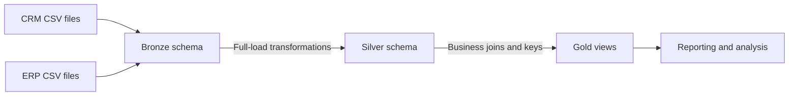

# SQL Data Warehouse Project

A SQL Server data warehouse built with T-SQL that consolidates CRM and ERP source data into a layered analytics model. The project demonstrates a full-load ETL workflow—from raw ingestion and data cleansing through dimensional modeling—ending in customer, product, and sales views for reporting and analysis.

## Project overview

The warehouse follows the **Medallion architecture**:

| Layer | Purpose | Examples |
|---|---|---|
| **Bronze** | Stores source-shaped CRM and ERP data loaded from CSV files. | `crm_cust_info`, `crm_prd_info`, `crm_sales_details`, `erp_cust_az12` |
| **Silver** | Cleans, standardizes, and transforms source data; resolves duplicates and normalizes dates and values. | `crm_cust_info`, `crm_prd_info`, `crm_sales_details`, `erp_loc_a101` |
| **Gold** | Presents business-friendly dimensional views for analytics. | `dim_customer`, `dim_products`, `fact_sales` |



The Silver processing includes trimming and standardizing customer attributes, retaining the latest customer record, deriving product date ranges, validating sales values and dates, and aligning customer identifiers across CRM and ERP. The Gold views join these cleaned datasets and expose customer and product dimensions alongside a sales fact view.

## Repository structure

```text
.
├── datasets/                 # Expected location for source CSV files (not included here)
├── docss/                    # Data catalog, naming conventions, and architecture/model diagrams
├── scripts/
│   ├── init_database.sql     # Creates DataWarehouse and bronze/silver/gold schemas
│   ├── bronze/               # Bronze table DDL and full-load CSV procedure
│   ├── silver/               # Silver table DDL and cleansing/transformation procedure
│   └── gold/                 # Gold analytical views
├── tests/                    # Manual Silver- and Gold-layer data-quality queries
└── LICENSE                   # MIT License
```

## Technology

- **Database:** Microsoft SQL Server
- **Language:** T-SQL
- **Data ingestion:** SQL Server `BULK INSERT` from CSV files
- **Model:** Bronze/Silver/Gold layers, with Gold views organized as dimensions and a fact table

## Getting started

### Prerequisites

- A Microsoft SQL Server instance with permission to create databases, schemas, tables, procedures, and views.
- SQL Server Management Studio (SSMS), Azure Data Studio, or `sqlcmd` to execute the scripts. Use a client that supports SQL Server's `GO` batch separator.
- The six source CSV files listed below. They are **not included** in this repository; place them in a location accessible to the SQL Server service account.

Expected source files:

```text
datasets/source_crm/cust_info.csv
datasets/source_crm/prd_info.csv
datasets/source_crm/sales_details.csv
datasets/source_erp/loc_a101.csv
datasets/source_erp/cust_az12.csv
datasets/source_erp/px_cat_g1v2.csv
```

> **Important:** `scripts/bronze/ddl_load_data_bronze.sql` currently contains machine-specific absolute Windows paths in its `BULK INSERT` statements. Update each path to the actual CSV location visible to SQL Server before running the load procedure. For a remote SQL Server, the path must be accessible from the server, not just from your workstation.

### Build and load

Run the scripts in order, connecting to the target SQL Server instance. The SQL files can be opened and executed in SSMS/Azure Data Studio, or run with `sqlcmd` (for example, `sqlcmd -S <server> -E -i scripts/init_database.sql`).

1. Run `scripts/init_database.sql` to create the database and schemas.
2. Run `scripts/bronze/ddl_script.sql` and `scripts/silver/ddl_silver.sql` to create layer tables.
3. Run `scripts/bronze/ddl_load_data_bronze.sql` to create `bronze.load_bronze`, then execute it:

   ```sql
   USE DataWarehouse;
   GO
   EXEC bronze.load_bronze;
   GO
   ```

4. Run `scripts/silver/proc_silver_layer.sql`. It creates and executes `insert_into_silver`, loading the Silver tables from Bronze.
5. Run `scripts/gold/gold.layerviews.sql` to create or alter the Gold views.
6. Run the quality checks in `tests/` against the loaded layers and investigate any returned rows.

> **Destructive operation:** `scripts/init_database.sql` drops and recreates the `DataWarehouse` database if it already exists. This permanently deletes its contents. Use only in a disposable development environment or after verifying backups and changing the script to suit your needs.

## Example queries

```sql
USE DataWarehouse;
GO

SELECT TOP (100) * FROM gold.dim_customer;
SELECT TOP (100) * FROM gold.dim_products;
SELECT TOP (100) * FROM gold.fact_sales;
GO
```

Example sales summary by customer:

```sql
SELECT
    c.customer_id,
    c.first_name,
    c.last_name,
    SUM(f.sales) AS total_sales
FROM gold.fact_sales AS f
JOIN gold.dim_customer AS c
    ON c.customer_key = f.customer_key
GROUP BY c.customer_id, c.first_name, c.last_name
ORDER BY total_sales DESC;
```

## Data quality

The SQL scripts in `tests/` are manual validation queries, not an automated test runner. The Silver checks cover duplicate or null keys, whitespace, standardization, date validity, and sales arithmetic. Gold checks cover dimension-key uniqueness and fact-to-dimension relationships. Queries marked with an expectation of “No results” should return no rows for a clean dataset; distinct-value checks are intended for inspection.

## Documentation

- [Gold-layer data catalog](docss/data_catalog.md)
- [Naming conventions](docss/naming_conventions.md)
- [Warehouse architecture diagram](docss/Data_Warehouse_Architecture.drawio.png)
- [Data flow diagram](docss/data_flow.drawio.png)
- [Data model diagram](docss/data_model.drawio.png)
- [Silver-layer model diagram](docss/DATAMODEL_SILVER%20LAYER.drawio.png)
- [Data layers document](docss/data_layers.pdf)

## License

This project is available under the [MIT License](LICENSE).
